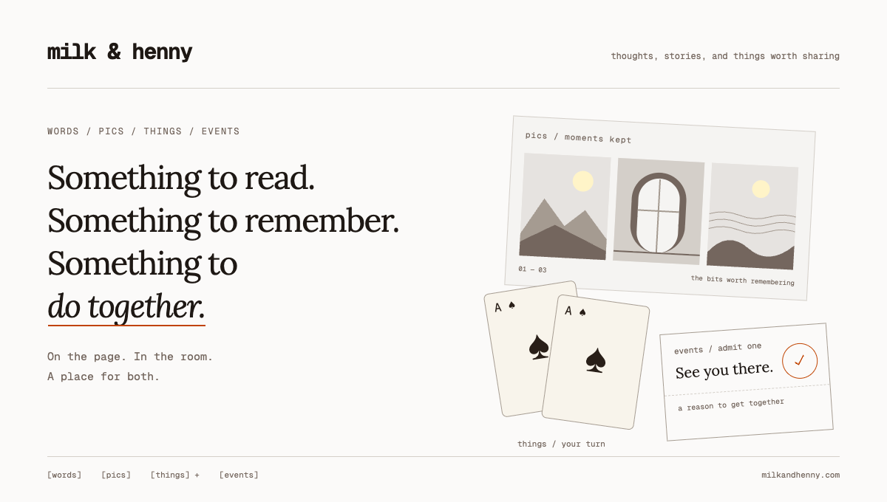
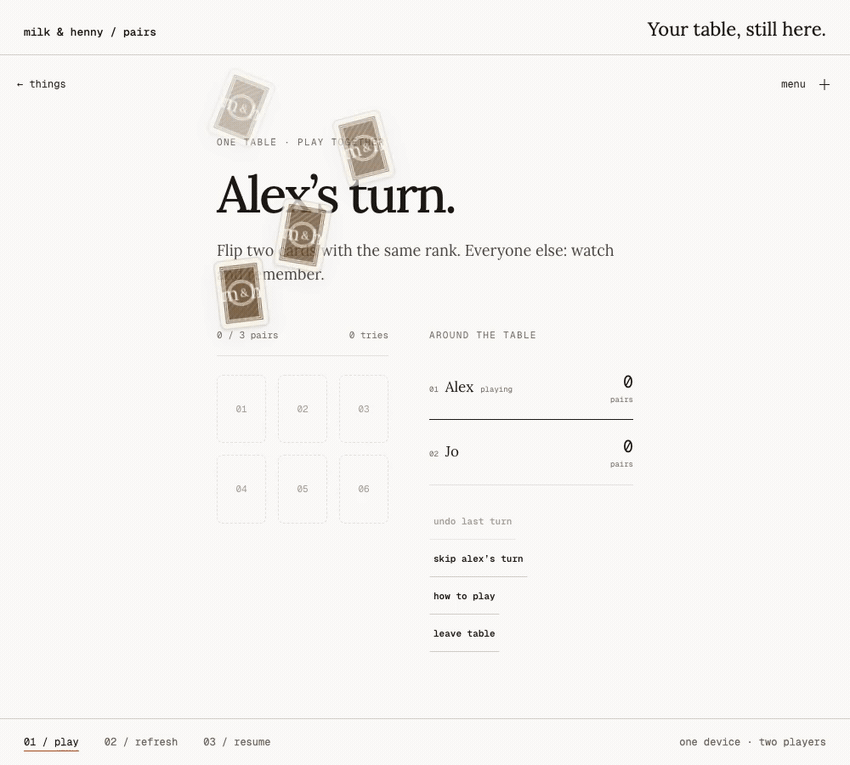

# milk & henny

Thoughts, stories, and things worth sharing.



[Visit the site](https://milkandhenny.com) · [Explore Things](https://milkandhenny.com/things) · [Architecture](docs/architecture.md) · [Docs](docs/README.md)

Milk & Henny publishes writing and photo albums, hosts games, and provides tools for private
file sharing and events. The same application handles the public pages and the work behind them:
editing a post, running a shared game, issuing tickets, and checking people in.

## What's here

| Area          | What it does                                                                 |
| ------------- | ---------------------------------------------------------------------------- |
| **Words**     | Essays, stories, and notes, with an editor and private sharing.              |
| **Pics**      | Photo albums, captions, responsive images, and deliberately published media. |
| **Things**    | Games for a spare minute or a room full of people, plus a pitch studio.      |
| **Events**    | Event pages, tickets, waitlists, attendee access, and door tools.            |
| **Transfers** | Private file sharing with expiry, upload recovery, and media previews.       |

Play [Pairs](https://milkandhenny.com/things/pairs) from memory,
[Hot & Cold](https://milkandhenny.com/things/hot-and-cold) for a hidden-word puzzle, or
[Family Feud](https://milkandhenny.com/things/family-feud) for a host-led room.
Browse [Words](https://milkandhenny.com/words) and [Pics](https://milkandhenny.com/pics) for writing and albums.

## A table that survives a refresh

<picture>
  <source media="(prefers-reduced-motion: reduce)" srcset="docs/assets/pairs-recovery.png" />
  
</picture>

A recording of the local application: two players on one device, a matching pair, a real page
reload, and the same table restored. [Watch the video](docs/assets/pairs-recovery.mp4) ·
[Capture notes and source](docs/assets/README.md#pairs-recovery-demo).

## What it's working towards

Reading should be unhurried. Shared games should leave room for conversation. Uploads, tickets,
and accepted game actions should recover after an interruption. Privacy and publication should
be clear to the person sharing. [Product direction](docs/product.md) explains these priorities.

## How it's built

<picture>
  <source media="(prefers-color-scheme: dark)" srcset="docs/assets/architecture-dark.png" />
  
</picture>

<details>
<summary>Follow a request and a media job</summary>

<picture>
  <source media="(prefers-reduced-motion: reduce) and (prefers-color-scheme: dark)" srcset="docs/assets/architecture-dark.png" />
  <source media="(prefers-reduced-motion: reduce)" srcset="docs/assets/architecture-light.png" />
  <source media="(prefers-color-scheme: dark)" srcset="docs/assets/architecture-flow-dark.gif" />
  
</picture>

A drawn sequence of a read and a queued media job. The timing is illustrative.
[Light video](docs/assets/architecture-flow-light.mp4) · [Dark video](docs/assets/architecture-flow-dark.mp4).

</details>

One TanStack Start / React application, served by Nitro as a Node process. Features own their
rules; routes and server functions expose them. Postgres owns records, transactions, rooms,
and durable work. R2 holds private sources and intentional public derivatives.

Effect coordinates fallible backend work and subsystem lifetimes. Game rules, validation,
repositories, and browser code stay ordinary TypeScript. Heavy media can run in a separate worker
using the same Docker image. The application can run on Railway or another container host.

The [architecture overview](docs/architecture.md) explains the boundaries and follows a request
through the system. The [design language](docs/design-language.md) explains the warm paper,
serif reading type, monospace controls, and restrained motion.

## Run it locally

Use the Node version in [Dockerfile](Dockerfile) and the pnpm version pinned in
[package.json](package.json). Start Docker, then:

```bash
pnpm install --frozen-lockfile
pnpm dev:setup
pnpm dev
```

Open [127.0.0.1:3000](http://127.0.0.1:3000). Local mode supplies Postgres, object storage, and
Mailpit; it excludes inherited remote credentials and dotenv files. The first setup downloads
service images and the semantic model. Later starts use the cached copies.

[Local development](docs/local-development.md) covers sign-in, data, email, and stopping services.
[Deployment](docs/deployment.md) covers configuration and the production image.

## Find your way around

| Path                                          | Purpose                                                  |
| --------------------------------------------- | -------------------------------------------------------- |
| [`src/routes`](src/routes)                    | Pages, URL state, and HTTP boundaries                    |
| [`features`](features)                        | Product workflows, rules, and feature UI                 |
| [`components`](components) · [`hooks`](hooks) | Shared interface and browser behavior                    |
| [`lib/platform`](lib/platform)                | Database, storage, email, payments, and runtime adapters |
| [`lib/shared`](lib/shared)                    | Environment-safe constants and utilities                 |
| [`server/plugins`](server/plugins)            | Startup, readiness, and shutdown                         |
| [`ops`](ops) · [`scripts`](scripts)           | Operations, local tools, and generated assets            |
| [`docs`](docs/README.md)                      | Product, architecture, contracts, and runbooks           |

For code changes, start with `pnpm check` and the tests for the behavior you changed. Build when
bundling or server/client boundaries change. The [verification guide](docs/testing.md) describes
the broader release checks.

The repository is available for viewing and reference under its [license](LICENSE).
