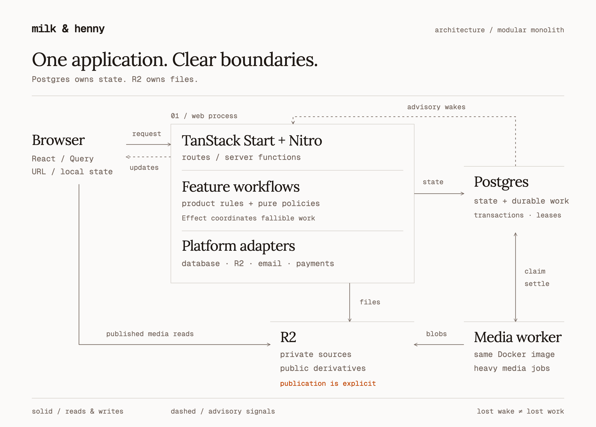
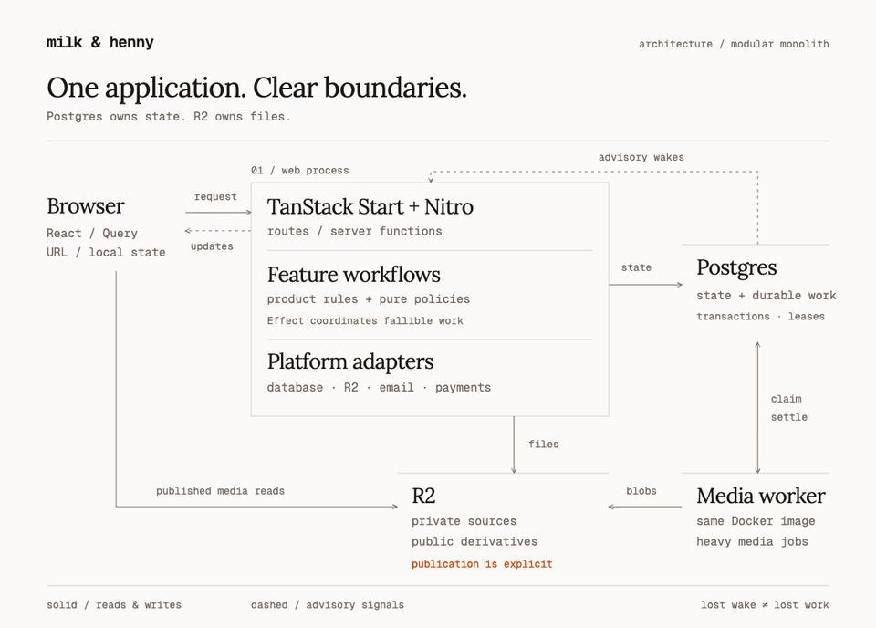
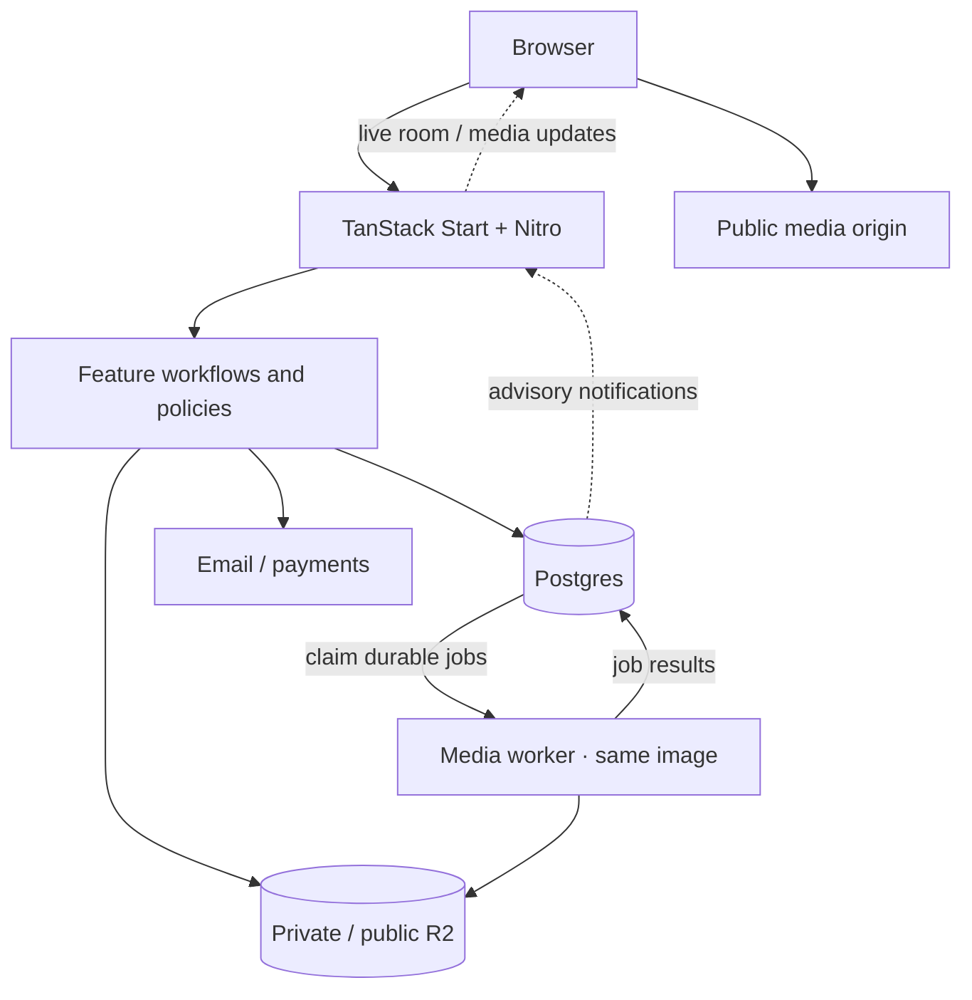

# Architecture

Milk & Henny is a modular monolith. Writing, galleries, games, transfers, and event operations
share one application, while each feature owns its rules and state transitions.

TanStack Start serves React pages and server functions. Nitro packages the Node server. The same
Docker image runs the web application and, when needed, a separate heavy-media worker.

## System shape

<picture>
  <source media="(prefers-color-scheme: dark)" srcset="assets/architecture-dark.png" />
  
</picture>

Follow a request and a media job

<picture>
  <source media="(prefers-reduced-motion: reduce) and (prefers-color-scheme: dark)" srcset="assets/architecture-dark.png" />
  <source media="(prefers-reduced-motion: reduce)" srcset="assets/architecture-light.png" />
  <source media="(prefers-color-scheme: dark)" srcset="assets/architecture-flow-dark.gif" />
  
</picture>

A drawn sequence of a read and a queued media job. The timing is illustrative.
[Light video](assets/architecture-flow-light.mp4) · [Dark video](assets/architecture-flow-dark.mp4).

Text diagram

Postgres owns application records and durable work. R2 owns bytes. Notifications reduce latency;
readers and consumers reconcile durable state if a notification is lost. The web process also
runs product schedules and daily recovery under database leases.

The host supplies configuration and a port. Railway is one deployment adapter; the application
artifact is `.output/server/index.mjs`. See [deployment](deployment.md).

## Code ownership

Paths below are relative to the repository root. Feature modules live in `features/`, outside `src`.

| Boundary                               | Owns                                                                              |
| -------------------------------------- | --------------------------------------------------------------------------------- |
| `src/routes`                           | URLs, loaders, transport validation, coarse authorization, and response shape     |
| `features/*/*.functions.ts`            | TanStack server-function entry points                                             |
| `features/*/*.server.ts`               | Workflows and durable product rules                                               |
| `features/*/ui` and feature components | Interaction and rendering                                                         |
| `components`, `hooks`                  | Shared UI and browser capabilities                                                |
| `lib/platform`                         | Persistence, storage, email, payments, runtime, logging, and provider translation |
| `lib/shared`                           | Pure, environment-safe constants and utilities                                    |
| `server/plugins`                       | Process startup, readiness, and shutdown                                          |
| `ops`, `deploy`, `scripts`             | Independently invoked operations, deployments, and build/local tools              |

Routes collect intent and shape responses. Feature workflows decide what is allowed and what
changes. Workers execute those same workflows. Modules importing secrets, platform adapters, or
`node:crypto` stay behind `.server.ts` boundaries; browser contracts stay pure.

Cross-feature workflows live at a neutral composition edge. For example,
`features/event-operations` combines event and ticket data without making events and tickets
import one another in both directions. Games persist neutral result envelopes through
`features/game-results`; they do not own event reward policy.

## Follow a request

1. A route loader prefetches critical page data through a feature query and server function.
2. The server authorizes the read and calls the feature workflow.
3. The workflow reads authoritative records and returns a domain result.
4. React observes the same Query entry after hydration.
5. A command crosses the authorized server boundary, commits its mutation, then updates or
   invalidates the affected browser views.

The browser cache does not decide access or establish that a remote mutation succeeded. An
unsaved form retains its working copy and base revision. Capability pages, live room projections,
upload execution, and offline recovery have specialized owners; see [server state](server-state.md).

## Durable state and side effects

| Store           | Responsibility                                                                                               |
| --------------- | ------------------------------------------------------------------------------------------------------------ |
| Postgres        | Content, tickets, sessions, rate limits, rooms, transfer metadata, outboxes, jobs, leases, and audit records |
| Private R2      | Incoming uploads, source media, transfer files, and private pitch assets                                     |
| Public R2       | Intentionally published derivatives and editorial media                                                      |
| Git             | Source, migrations, fixtures, content/ruling assets, and generated build inputs                              |
| Process memory  | Bounded connections, caches, and disposable execution state                                                  |
| Browser storage | Versioned local recovery, offline working copies, and preferences                                            |

The documented production topology and the default local environment use Postgres stores.
Redis adapters remain for explicit non-production configurations. Historical import notes are
[archived](archive/README.md); their pre-cutover status statements are not current architecture.
Deployment configuration must still be verified independently of this document.

An independently addressable record represents each mutable entity. Relational constraints and
transactions enforce contended operations. Admission uses an atomic conditional update; capacity
checks serialize against the ticket type; a refund and seat release commit together.

Durable work is recorded atomically beside the state that creates it. Consumers handle repeated
delivery. A crashed worker leaves a recoverable lease or job; a lost wake cannot erase work.
External mutations require explicit idempotency or outcome reconciliation before retry. See
[durable work](durable-work.md).

Migrations are append-only in `lib/platform/migrations.server.ts`. Development can apply them at
boot. Restricted runtime roles use `DATABASE_SCHEMA_MODE=verify` after a separate migration step.
Failed schema initialization leaves readiness unhealthy. See [database roles](postgres-runtime-roles.md).

## Backend execution

Effect owns orchestration where deadlines, cancellation, bounded concurrency, retries, resource
lifetime, or typed infrastructure failures justify it. Ordinary TypeScript owns deterministic
rules, validation, repositories, browser state, and game transitions.

| Managed runtime | Responsibility                                                          |
| --------------- | ----------------------------------------------------------------------- |
| Events          | Events, tickets, attendee operations, communications, and scheduling    |
| Media           | Media-worker lifetime, transfers, and bounded media workflows           |
| Multiplayer     | Server-authoritative rooms, commands, realtime, and game-pool workflows |
| Pitches         | Pitch Night workflows and presentation lifetime                         |

One independently started subsystem gets one runtime. Services extend its Layer; facades do not
create additional runtimes. Promise conversion belongs at TanStack, Nitro, worker, or CLI edges,
with the active abort signal. The full contract is [Effect lifecycle](effect-lifecycle.md).

## Shared play

The server owns shared room state. A command uses explicit clock, randomness, and ID inputs for
its pure transition, commits the room mutation and result outbox atomically, then publishes an
advisory wake. Reconnect reads a redacted authoritative projection and reconciles sequence and
revision information.

Shared infrastructure owns credentials, wake transport, backpressure, and lifetime. Each game owns
rules, phase rhythm, privacy, roles, readiness, and correction. Paired-device judging and
server-authoritative party rooms compose common primitives without sharing one universal engine.
Local games retain their own reducer and tab-scoped recovery.

Every mode declares its device topology and attention profile. A phone needs a role in the game;
joining a room is not a reason by itself. See [room-first multiplayer](room-first-multiplayer.md)
and [multiplayer testing](multiplayer-testing.md).

Judging assets use independent semantic revisions carried through assets, rooms, recovery, and
results. Hot & Cold also requires deterministic rank/hint checks and human editorial approval of
upcoming dailies. Build inputs and their review trail remain in Git.

## Media and event operations

Uploads stage privately. Feature finalization validates ownership and bytes before promoting
objects. Publishing copies intentional derivatives to the public bucket; originals stay private.
Tracked copy/delete work has its own recoverable [object-operation ledger](media-object-operations.md).

Images and GIFs finalize inline. In hybrid mode, RAW previews and video posters use the Postgres
queue and a separate worker with `MEDIA_WORKER_ROLE=worker`. Local mode processes inline and
needs no worker. See [media pipeline](media-pipeline.md) and [media worker](media-worker.md).

Ticket ownership, personal identity, and game identity remain distinct. Scanners and checkpoints
use authoritative request/response mutations, independent of room realtime. Event scoring is
quarantined: historical ledgers remain, but live points tools and automatic result consumption
are retired. Team assignment can use participant persistence without reopening scoring. See
[events platform](events-platform.md).

## Running and recovering

The web scheduler starts after database readiness. Per-job Postgres leases prevent overlapping
work across replicas and deploys. Product schedules and daily cleanup use bounded batches with
independent recovery paths; see [operations](operations.md).

- `/api/health` performs bounded required-capability probes and returns 503 when traffic should stop.
- `/health` presents the safe capability model.
- `/api/debug` requires admin access and provides deeper operational probes.

Secrets are runtime inputs. Public `VITE_*` values are build inputs. The container filesystem is
ephemeral; durable mutations belong in Postgres or storage. Traffic cutover requires healthy
readiness and a retained rollback deployment. Backup and restoration are separate operational
work, described in [disaster recovery](disaster-recovery.md).
